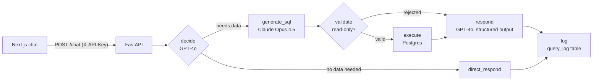

# AI Data Analyst Agent

Ask an e-commerce database questions in plain English — *"What's the total revenue from
delivered orders?"* — and get an answer backed by a real SQL query, with the result table and,
where it helps, a chart.

- **Backend:** Python, FastAPI, LangGraph, PostgreSQL — a state-machine agent that decides
  whether a question needs data, generates SQL, validates it, runs it and explains the result.
- **Frontend:** Next.js, TypeScript, Tailwind, Recharts — chat UI with tables, charts, CSV export
  and history.
- **Data:** the [Olist Brazilian e-commerce dataset](https://www.kaggle.com/datasets/olistbr/brazilian-ecommerce)
  (~100,000 orders, 9 tables) in Postgres (Supabase).
- **Deployed:** backend as a Docker container on a Google Cloud Compute Engine e2-micro VM;
  frontend on Vercel. The browser only talks to the frontend's `/api/chat` route, which
  forwards to the backend server-side, so the API token never reaches the browser.

Built twice on purpose: first as an **n8n** prototype to prove the idea, then **rewritten from
scratch in Python** to own every part of it. The frontend didn't change — both backends honour
the same JSON contract. The prototype's workflows and why I moved to
Python are in **[n8n-prototype/](n8n-prototype/)**; the full story, including the 14 problems I hit
and how I diagnosed each one, is in **[docs/build-report.md](docs/build-report.md)**.

```
backend/         FastAPI + LangGraph agent, tests, Dockerfile   (phase 2)
frontend/        Next.js chat UI, works with both backends
n8n-prototype/   the original n8n workflows                      (phase 1)
docs/            build report: 14 problems, diagnosed and fixed
```

## How it works



| Node | What it does |
|---|---|
| `decide` | GPT-4o decides whether the message needs the database and writes a precise description of the data to fetch. |
| `generate_sql` | Claude Opus 4.5 turns that description into PostgreSQL, grounded in a schema prompt with business rules and examples. |
| `validate` | Plain code, not a model: only a single `SELECT`/`WITH` query passes. Writes, DDL, stacked statements and comments are rejected. |
| `execute` | Runs the query from a small connection pool. A database error becomes a readable answer, not a 500. |
| `respond` | GPT-4o writes the answer as a validated Pydantic model: text, table, optional chart spec, and the SQL for transparency. |
| `log` | Writes every question, its SQL and the outcome to a Postgres audit table. Best-effort: logging can never break a response. |

Code: [`backend/app/graph.py`](backend/app/graph.py) (the agent),
[`validator.py`](backend/app/validator.py), [`db.py`](backend/app/db.py),
[`main.py`](backend/app/main.py) (API), [`models.py`](backend/app/models.py) (the JSON contract).

## Engineering decisions

- **The model proposes, code decides.** The LLM never gets write access: SQL passes a
  deterministic validator before it reaches the database
  ([tests](backend/tests/test_validator.py)).
- **Self-healing database connections.** Supabase's pooler silently closes idle connections, so
  a long-running API eventually picks a dead one. The DB layer recognises that error class,
  discards the connection and retries once with a fresh one — instead of needing a restart
  ([tests](backend/tests/test_db.py), report challenge 14).
- **Don't trust a fluent answer.** A "top categories" result looked fine but the numbers were
  too small for 100k orders. Checking row counts against the dataset's documented totals
  found silent partial imports in 5 of 9 tables; they were re-imported with `psql \copy` and
  verified (challenge 10).
- **Audit log in the database, not in Google Sheets.** The prototype logged to Sheets — an
  extra API, OAuth and rate limits. The rewrite uses a table in the database it already has
  ([`sql/query_log.sql`](backend/sql/query_log.sql), challenge 12).
- **Docker for the deploy.** The VM's new default Python couldn't install pinned dependencies;
  pinning Python in the image fixed it for good (challenge 13). One Uvicorn worker keeps memory
  predictable on an e2-micro.

## Run it

**Backend** (Python 3.12):

```bash
cd backend
cp .env.example .env          # database URL, API keys, auth token
python -m venv .venv && source .venv/bin/activate
pip install -r requirements.txt
psql "$DATABASE_URL" -f sql/query_log.sql
uvicorn app.main:app --reload # http://localhost:8000/health
```

```bash
curl -X POST http://localhost:8000/chat \
  -H "Content-Type: application/json" -H "X-API-Key: change-me" \
  -d '{"message": "How many orders do we have?", "session_id": "demo"}'
```

Docker: `docker build -t ai-data-analyst backend && docker run --env-file backend/.env -p 8000:8000 ai-data-analyst`

**Frontend** (Node 18+):

```bash
cd frontend
cp .env.example .env.local    # BACKEND_URL + BACKEND_API_KEY
npm install && npm run dev    # http://localhost:3000
```

**Tests** — no database or API keys needed (the graph and the pool are replaced with fakes):

```bash
cd backend
pip install -r requirements-dev.txt
pytest
```

## Known limitations and next steps

- **No conversation memory yet** in the Python version (the n8n prototype had it). Next:
  LangGraph's checkpointer keyed on `session_id`.
- **The validator is a blocklist.** It is conservative (a string literal containing `update`
  is rejected too) and is not the only line of defence it should be: the next step is a
  read-only database role for the API, so even a missed pattern can't write.
- **No rate limiting on the public demo yet:** every question costs LLM calls. Next: a
  per-session limit in the `/api/chat` route.
- **No evaluation harness yet** — a fixed set of questions with known answers, run on every
  prompt change, is the next thing I'd build.
