# Building an AI Data Analyst Agent

_From a no-code prototype to a self-built AI agent — n8n, then a ground-up Python/LangGraph rewrite, deployed on Google Cloud_

_Complete technical build report, with screenshots · Personal project_

## Executive Summary

This project is an AI-powered data analyst that answers plain-English questions about an e-commerce database by writing and running real SQL against a live Postgres database. It was built twice, deliberately: first as a no-code automation workflow (n8n), to prove the concept and surface real integration problems; then rebuilt from scratch in hand-written Python — a LangGraph-orchestrated agent behind a FastAPI service — to gain real command of the underlying mechanics and to show the ability to build the thing itself, not just configure an existing tool.

Across the build and the first weeks in production, eighteen distinct, real engineering problems were diagnosed and resolved: cloud networking and IPv6 routing, OAuth setup and API-key scoping across two LLM providers, cloud billing and free-tier cost traps, repeated memory exhaustion on constrained hosts, a silently corrupted dataset affecting five database tables, a multi-layer environment-variable leak, a production connection-pool failure, a from-scratch container deployment on a small cloud VM, a browser-blocked https-to-http call after deploying the frontend, and a small unexpected cloud charge. Each was resolved by direct investigation — reading logs, testing components in isolation, checking raw data against documented ground truth — rather than by guessing. Screenshots from the actual debugging sessions are included throughout; API keys and other secrets have been redacted.

## System Architecture

### Phase 1 — the n8n prototype

A webhook-triggered n8n workflow used GPT-5.1 as a conversational agent with tool-calling access to a second, independent n8n workflow. That workflow used Claude Opus 4.5 to generate SQL from a natural-language description, validated it against a regex-based safety blocklist, ran it against a Supabase Postgres database holding the Olist Brazilian e-commerce dataset (~100,000 orders), and logged every query to Google Sheets.

### Phase 2 — the Python / LangGraph rewrite

The same architecture was rebuilt as original code. A LangGraph state machine replaces the n8n canvas: plain Python functions for deciding whether a query is needed, generating SQL, validating it, executing it, formatting the response and logging it, connected by real conditional edges. A FastAPI service exposes this graph over HTTP with header-token authentication, and the existing Next.js frontend works against it unchanged because both backends honor the same JSON contract. The backend runs as a Docker container on a Google Cloud Compute Engine e2-micro VM — chosen because n8n itself proved too heavy for free-tier hosts (see Challenge 9).

### Technology Stack

| Layer | Phase 1 (n8n) | Phase 2 (Python rewrite) |
|---|---|---|
| Orchestration | n8n workflow canvas | LangGraph state graph (Python) |
| Conversational agent | GPT-5.1 via n8n LangChain node | GPT-4o via LangChain |
| SQL generation | Claude Opus 4.5 via n8n | Claude Opus 4.5 via LangChain |
| Validation | n8n Code node (regex blocklist) | Plain Python function, same logic |
| Database | Supabase (managed Postgres) | Same Supabase database |
| Audit logging | Google Sheets API | Dedicated Postgres table in the same database |
| Web / API layer | n8n Webhook + Header Auth | FastAPI + Uvicorn, header-token auth |
| Deployment | n8n in Docker (local); attempts on GCP and Render | Docker container on GCP Compute Engine |
| Frontend | Next.js, TypeScript, Tailwind | Same frontend, now on Vercel behind a server-side `/api/chat` route |

## The Build & Debug Journey

What follows are the real problems hit across both phases, in the order they occurred. Each is presented as problem → diagnosis → resolution, because that loop — not the final working code — is the evidence of engineering skill, and because the most common interview question, “how do you debug something you've never seen before,” is best answered with real examples.

### Phase 1 — Building the n8n prototype

#### Challenge 1 · Supabase connection failed with an IPv6 error

**What happened**

The first connection attempt from n8n to Supabase failed instantly with “ENETUNREACH” against an IPv6-looking address, despite correct credentials.

**How it was diagnosed**

The error's exact shape — a raw IPv6 address and a network-unreachable failure, rather than an authentication failure — pointed to a network-path problem, not a credentials problem. Supabase's default “direct connection” hostname only resolves over IPv6, which most self-hosted environments cannot route to.

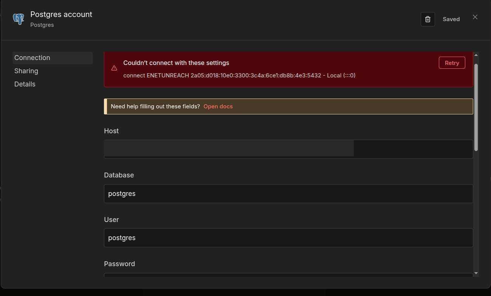

n8n's Postgres credential test failing with ENETUNREACH against an IPv6 address.

**How it was resolved**

Switched to Supabase's IPv4-compatible “Session pooler” connection. This needed a second adjustment: the pooler's username embeds the project reference (postgres.<project-ref>), because it is shared infrastructure serving many projects.

**Skill demonstrated**

Reading an error's exact shape (an IP literal, a specific errno) to narrow down which network layer is failing, rather than assuming every connection error means wrong credentials.

#### Challenge 2 · A password containing “@” silently broke a connection string

**What happened**

A Python script using the same database credentials failed, trying to resolve a hostname that was actually a fragment of the password itself.

**How it was diagnosed**

Connection strings use @ as a reserved delimiter between credentials and host. Because the real password contained @ characters, the parser split the string in the wrong place.

**How it was resolved**

URL-encoded the special characters in the password (@ became %40) before placing it in the connection string.

**Skill demonstrated**

Recognizing that credentials embedded in a URL-formatted string must be encoded for characters with special meaning in that format — a common, easy-to-miss integration bug.

#### Challenge 3 · Google Sheets OAuth required building a Google Cloud application from scratch

**What happened**

Connecting n8n to Google Sheets did not open a normal login popup. Instead the credential form asked for a Client ID and Client Secret, with nothing to fill in.

**How it was diagnosed**

This is expected for self-hosted tools: unlike a SaaS product with a pre-registered identity, a self-hosted instance must register its own OAuth application before Google will authenticate through it. After registering one, a second error (“access blocked”) appeared, which was distinguished from Google's normal “unverified app” warning: the account had not yet been added as an approved test user.

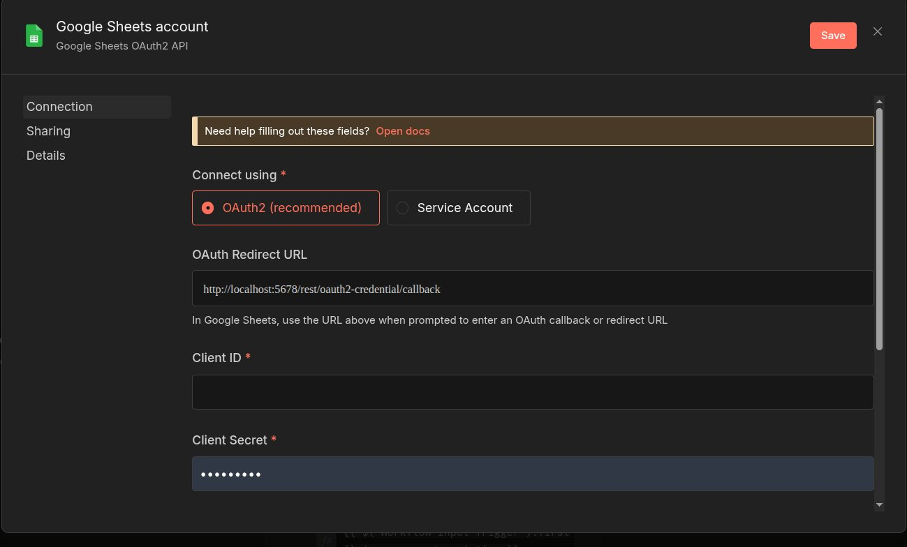

n8n's Google Sheets credential asking for a Client ID and Secret that did not exist yet.

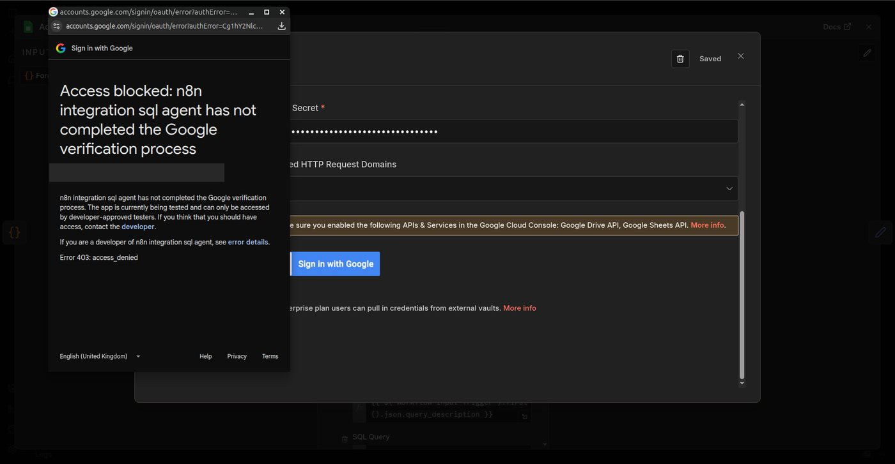

Google's “access blocked” error: the app was in testing mode and the account was not yet an approved test user.

**How it was resolved**

Registered a project in Google Cloud Console, enabled the Sheets and Drive APIs, configured the OAuth consent screen, generated a Client ID/Secret pair with the exact redirect URI n8n required, and added the account as a test user.

**Skill demonstrated**

Working through a multi-step cloud IAM/OAuth setup independently, including reading platform-specific error text closely enough to tell an expected warning from a real configuration gap.

#### Challenge 4 · An Anthropic API key was rejected with an undocumented workspace error

**What happened**

Every call to Claude failed with “anthropic-workspace-id is required when authenticating with an identity-linked API key,” and n8n's built-in credential test gave conflicting, unhelpful errors on different attempts.

**How it was diagnosed**

Rather than trust the unreliable credential test, the key was verified directly against Anthropic's API with Postman. That isolated the real cause: the key had been created as a personal, cross-workspace key, a type that must declare which workspace it acts in on every request. Two smaller problems (a wrong endpoint URL and a missing required header) were found the same way.

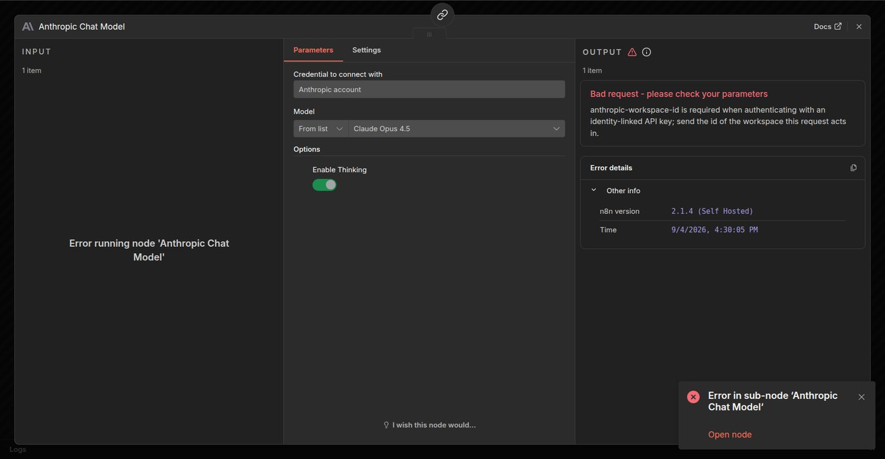

The workspace-ID error as it appeared inside the n8n workflow run.

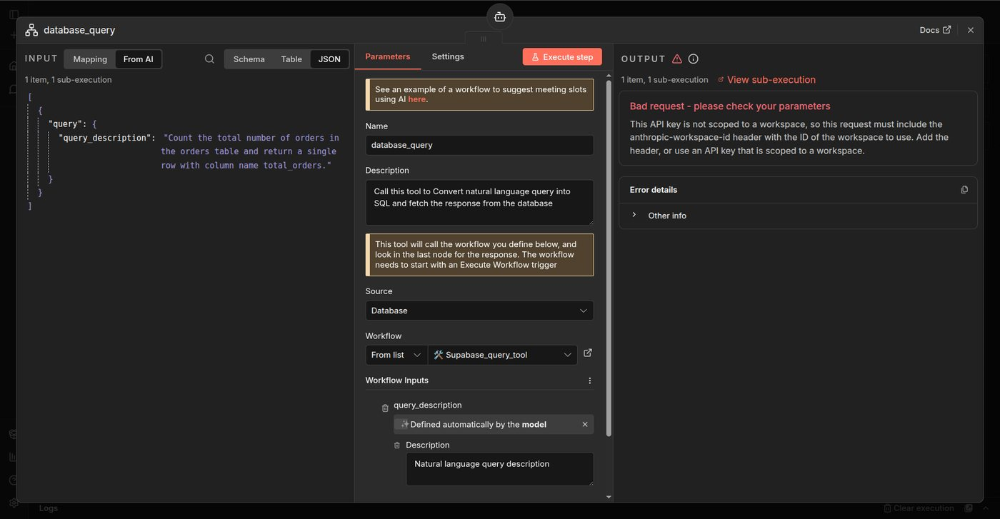

The same failure surfacing through the agent's database tool.

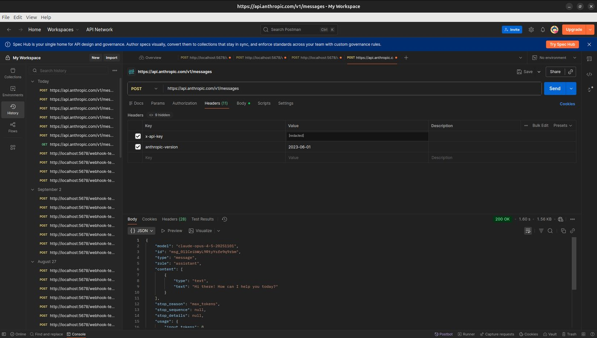

A direct Postman call with the workspace-scoped key succeeding (key redacted).

**How it was resolved**

Created a new API key explicitly scoped to a single workspace at creation time, which removed the need for the extra header. A direct Postman call then returned a normal response, proving the key itself was fine.

**Skill demonstrated**

Not trusting a single tool's error reporting when integrating third-party APIs; building an independent test to get ground truth before interpreting a new, undocumented platform behavior.

#### Challenge 5 · A sub-workflow tool call failed until it was explicitly published

**What happened**

Wiring the agent's database tool to call a second workflow worked in the editor, but the workflow was flagged as unusable, with a warning that it “must be published before using.”

**How it was diagnosed**

n8n distinguishes between a saved draft and a published, callable version of a workflow used as a tool — saving edits does not update what is actually live.

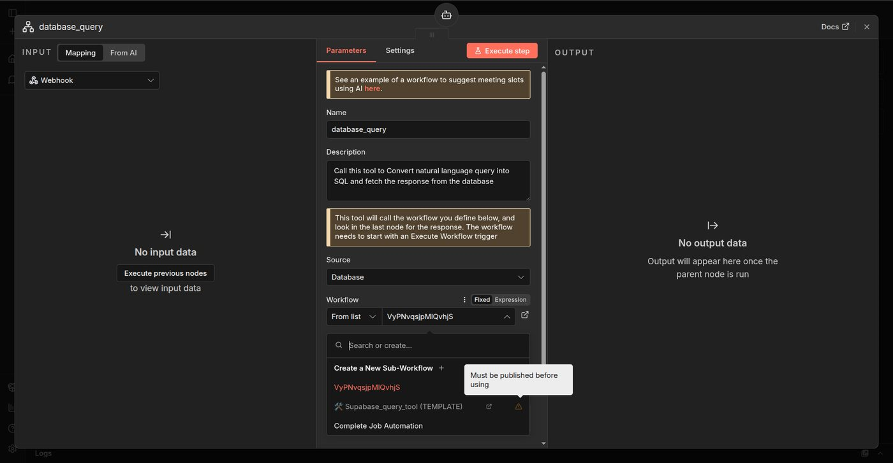

n8n refusing to link the sub-workflow until it was published.

**How it was resolved**

Published the sub-workflow explicitly, and adopted the habit of re-publishing after every future edit.

**Skill demonstrated**

Recognizing platform-specific lifecycle concepts that don't match assumptions carried over from other tools.

#### Challenge 6 · A schema mismatch between the AI's prompt and the actual database

**What happened**

A machine-generated schema dump of the live database showed a table named customer (singular), while the AI's prompt — and every other table — used customers (plural).

**How it was diagnosed**

Compared the schema dump against the prompt's hardcoded description, table by table, rather than assuming they matched because the data looked right.

**How it was resolved**

Renamed the table to match the prompt, since every other table and every query example already used the plural convention.

**Skill demonstrated**

Systematically cross-checking two independently maintained sources of truth instead of assuming they agree.

#### Challenge 7 · A Google Sheets logging step broke after a routine edit

**What happened**

After a small change, the logging step began failing with a “sheet not found” error, then, after that was fixed, a second issue where column mappings had silently swapped.

**How it was diagnosed**

n8n's Execution log was used to trace the failure to one specific node, confirming the core SQL generation and execution had actually succeeded and only the non-critical logging step was broken.

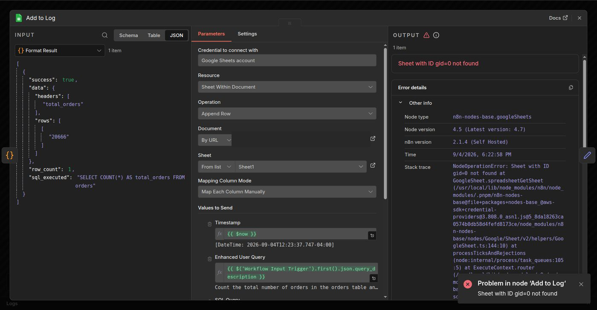

The logging node failing with a stale sheet reference, while the data it was about to log was correct.

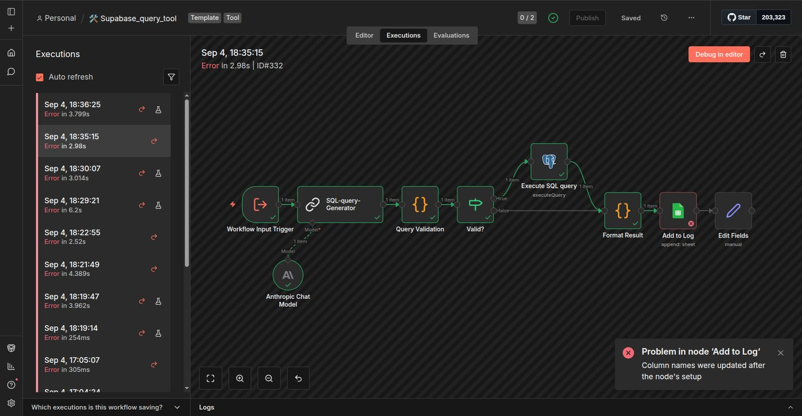

The execution trace: every node green except the final logging step.

**How it was resolved**

Rebuilt the Google Sheets node from scratch rather than continuing to patch a node with a stale internal cache of the spreadsheet's structure.

**Skill demonstrated**

Reading execution traces in a multi-node pipeline to isolate a failure to one component, and recognizing when a clean rebuild beats continued patching.

### Phase 1b — Taking n8n to the cloud, and hitting the ceiling

#### Challenge 8 · Cloud billing, a closed account, and a free-tier cost trap

**What happened**

Creating a Compute Engine VM on a project that had only ever been used for OAuth failed because no billing account existed. Creating one hit an opaque Google payments error that said to retry after 24 hours. Once it worked, the billing account later appeared as “closed,” and even after reopening it, the project turned out not to be linked to it. Separately, the VM cost estimator showed several dollars a month for a machine that was supposed to be free.

**How it was diagnosed**

Searching the exact error code showed this was a widespread, known billing-setup failure rather than a mistake in the card details, so the right move was to wait out the cooldown and retry. The billing console's account page showed “no projects linked,” which explained why an open account still wasn't usable: opening an account and attaching it to a project are separate steps. On the cost side, the estimate's line items were read one by one: the compute line is always shown at list price (the free-tier credit is applied later, on the invoice), but the boot disk line was a real problem — the default “balanced” disk type is not covered by the Always Free tier; only “standard” is.

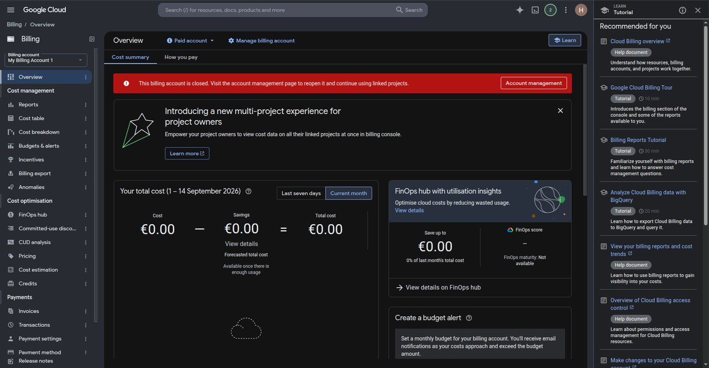

The billing account showing as closed after an earlier failed verification attempt.

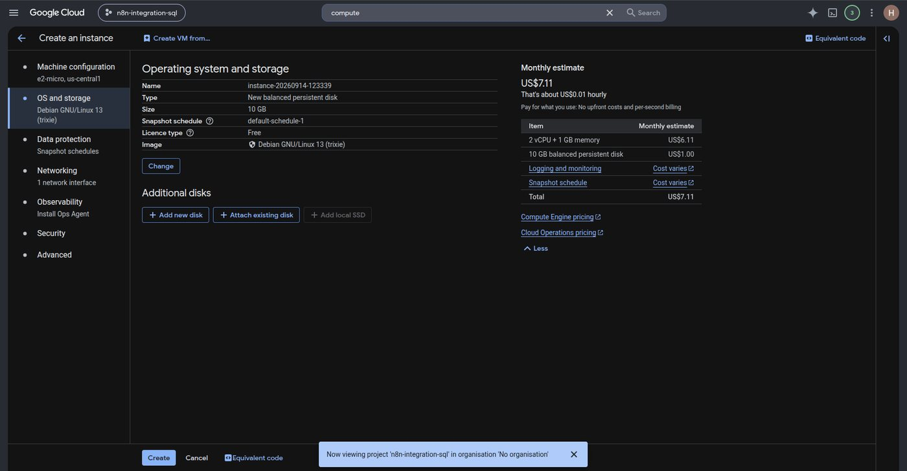

The cost estimate with the default “balanced” disk: $1.00/month for a disk that should be free.

After switching to a Standard disk, the disk line reads $0.00.

**How it was resolved**

Waited out the cooldown, reopened the billing account, linked the project to it, and set a €1 budget alert as a safety net. Switched the boot disk to Standard, after which the disk line dropped to $0.00. The VM was created in one of the three US regions where the e2-micro free tier applies.

**Skill demonstrated**

Reading cloud pricing line by line to avoid unexpected charges; adding a budget alert before spending anything; separating a cosmetic display quirk from a real cost.

#### Challenge 9 · n8n ran out of memory on two different free-tier hosts

**What happened**

n8n was deployed to the free GCP VM (1 GB RAM). Shortly afterward, SSH connections to the VM stalled and then failed with proxy errors. The same application was then tried on Render's free tier (512 MB), where the service reported “live” but the site returned 502 Bad Gateway.

**How it was diagnosed**

On GCP, the connection-troubleshooting tool reported sustained high CPU. The firewall was ruled out by opening the actual rule, which already allowed port 22 from all sources, so the proxy error was a symptom, not a cause. On Render, the application logs were read line by line and ended in a fatal JavaScript heap out-of-memory error, which occurred while n8n was running its first-boot database migrations. Research into n8n's own documentation and issue tracker showed this is a known pattern: the application bundles a full web editor, a database layer and hundreds of integration definitions, so even idle it uses a large share of 512 MB–1 GB. Render's pricing page was also checked closely: the $7 tier has the same 512 MB of RAM as the free tier (only the $25 tier increases memory), so paying for the cheaper upgrade would not have fixed anything.

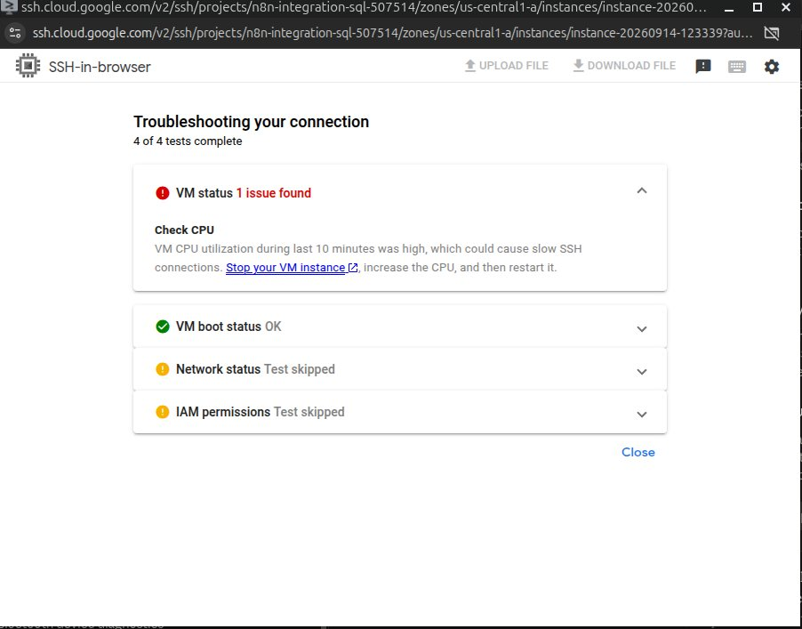

GCP's connection troubleshooter flagging sustained high CPU on the e2-micro VM.

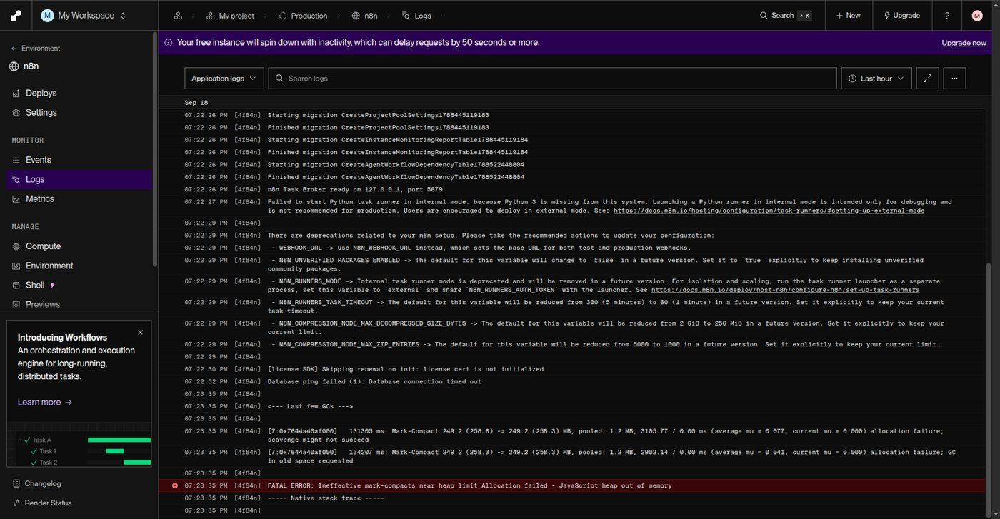

Render's logs ending in a fatal JavaScript heap out-of-memory error during n8n's first boot.

**How it was resolved**

Concluded that the constraint was the application's footprint, not either host. That decision — rather than paying for a larger machine or continuing to fight the free tier — led to rebuilding the agent as a lean Python service (Phase 2).

**Skill demonstrated**

Treating the same failure on two unrelated providers as evidence about the workload rather than the platforms; reading pricing tiers precisely so as not to spend money on the wrong fix; turning a repeated failure into an architectural decision.

### Phase 2 — The Python / LangGraph rewrite

#### Challenge 10 · A stale, unrelated API key silently overrode every .env file

**What happened**

Every call to Claude returned a 404, even though the same key succeeded moments earlier in a direct Postman test.

**How it was diagnosed**

The key actually being used was inspected directly with echo $ANTHROPIC_API_KEY, which printed a completely different key in OpenRouter's format (prefix sk-or-v1-). A grep through the shell startup files traced it to a leftover block in .bashrc from an earlier, unrelated project — which also set ANTHROPIC_BASE_URL to OpenRouter's servers, redirecting every request away from Anthropic. After that block was removed, the value still appeared in VS Code's integrated terminal but was empty in a separate system terminal, showing a second source of the same leak specific to the IDE.

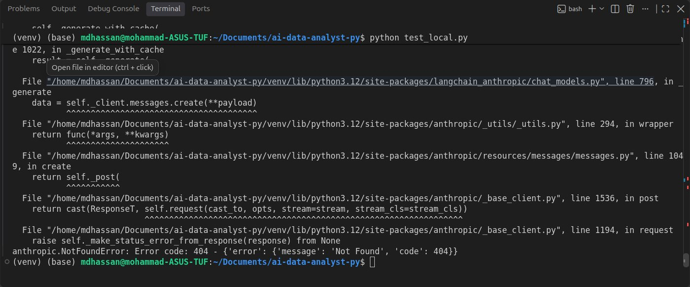

The 404 from Anthropic's API inside the Python app.

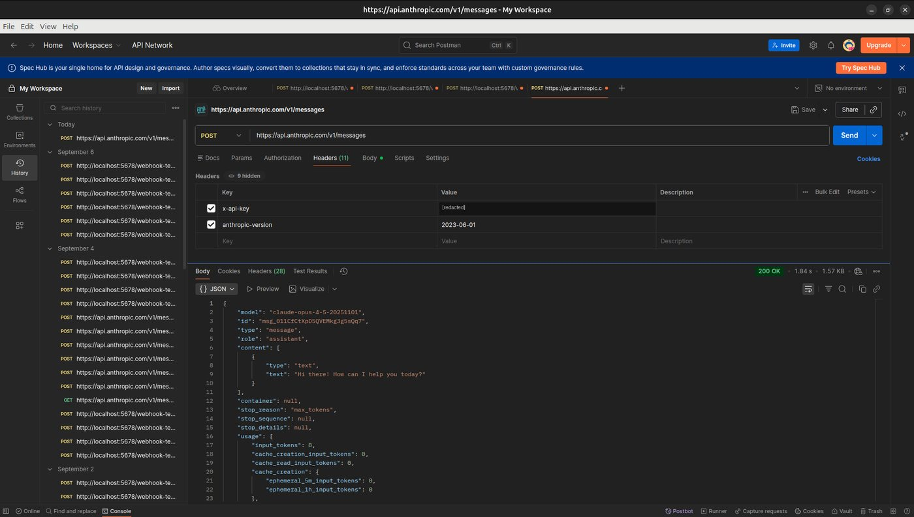

The same key succeeding in a direct Postman call (key redacted) — so the key was never the problem.

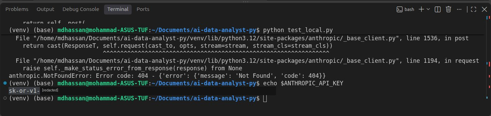

Inspecting the variable: it holds an OpenRouter-format key (value redacted), not the key in .env.

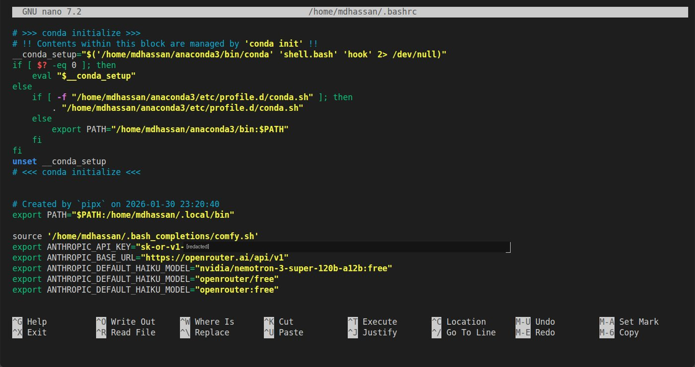

The source: a leftover block in .bashrc that also redirected the API base URL to OpenRouter (key redacted).

**How it was resolved**

Rather than keep hunting for every possible source, the application's variable was renamed to something used nowhere else on the machine, and the code was made defensive: it explicitly removes any stray base-URL override and force-sets the variable name the underlying SDK actually falls back to reading. The pipeline then returned correct results.

**Skill demonstrated**

Root-causing a bug across multiple independent layers (shell config, IDE-injected environment, library fallback behavior), and knowing when to stop tracing every leak and instead make the code robust against the whole class of problem.

#### Challenge 11 · A schema typo carried over from the original prompt went undetected until a new question exposed it

**What happened**

A question about top product categories returned a polite explanation that a required table was missing, instead of an answer.

**How it was diagnosed**

The generated SQL was inspected directly and found syntactically correct; the prompt referred to a translation table by a name that didn't match the database's real table name — a typo that had existed since the original n8n prompt and had never been exercised by an earlier test question.

**How it was resolved**

Confirmed the real table name against a fresh schema dump and corrected every reference across the system prompt.

**Skill demonstrated**

Treating a model's honest explanation of an error as a signal to fix the prompt, not evidence the model is broken; trusting a fresh introspection of the database over a prompt written weeks earlier.

#### Challenge 12 · A statistically implausible answer revealed silently corrupted data across five tables

**What happened**

A “top 5 categories” query returned counts in the tens, when a ~100,000-order dataset should produce counts in the thousands. Notably, the n8n version had already been reporting only 20,666 total orders weeks earlier — about one-fifth of the true figure — and nobody had noticed, because the answer looked plausible.

**How it was diagnosed**

Rather than accept a fluent answer, the table's real row count was checked against the dataset's documented size, which confirmed only about one-fifth of the rows were present. A single query counting every table showed the same partial-import problem in five of the nine tables, at inconsistent cutoffs — pointing to silent failures in the original browser-based CSV import rather than a fixed limit.

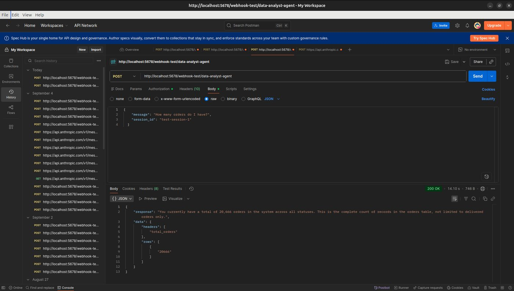

The n8n version confidently reporting 20,666 total orders — the real figure is 99,441. Nothing crashed, which is why it went unnoticed.

**How it was resolved**

Every affected table was truncated and re-imported with psql's \copy command — a bulk-load method that does not depend on a browser — and each row count was verified against the documented totals afterward. The same question then returned category counts in the thousands.

**Skill demonstrated**

Refusing to accept a fluent, non-crashing answer as proof of correctness; using independent domain knowledge as a check on the system's own output; auditing every related table rather than stopping at the first broken one.

#### Challenge 13 · A new orchestration framework rejected a node for a subtle reason

**What happened**

Adding an audit-logging step to the LangGraph state graph caused every request to fail with an internal error saying a node had not updated any state.

**How it was diagnosed**

The framework's error was read precisely rather than treated as opaque: it required every node to return a state update, and the new node's return value was an empty object — valid Python, but invalid under this framework's contract.

**How it was resolved**

Extended the state schema with one new field and had the logging node return a meaningful value against it.

**Skill demonstrated**

Reading framework-level error messages precisely rather than assuming a new tool is simply broken.

#### Challenge 14 · Replacing Google Sheets logging with a more production-appropriate design

**What happened**

The inherited design logged every query to Google Sheets, which brought an external API dependency, OAuth complexity and rate limits into a system that otherwise had none.

**How it was diagnosed**

Evaluated the inherited design against the project's own database, which was already connected and authenticated, making an external logging service an unnecessary point of failure.

**How it was resolved**

Added a dedicated audit-log table in Postgres, written to by a fire-and-forget function that swallows its own errors so a logging failure can never break a user-facing response. A temporary debug mode made failures visible while verifying that rows were actually landing.

**Skill demonstrated**

Recognizing when an inherited design decision should be re-evaluated rather than carried forward automatically.

#### Challenge 15 · A brand-new default Python version broke package installation on a fresh cloud VM

**What happened**

Installing dependencies on a fresh GCP VM failed while compiling NumPy from source, first for a missing C compiler and then for missing Python development headers. After those were installed, the install stalled and the VM became unresponsive to SSH.

**How it was diagnosed**

Each error was followed in turn rather than worked around: the build output showed that the VM's very new default Python (3.13) had no pre-built installer for an older, exactly-pinned dependency, forcing a from-source compile that the VM's small CPU could not complete.

**How it was resolved**

Instead of continuing to patch the host machine, the VM was recreated and the app was deployed as a Docker container built from the Dockerfile written earlier, which pins a stable Python (3.12-slim). Inside that image every dependency installed from pre-built packages — no compiler needed — and the container came up cleanly.

**Skill demonstrated**

Diagnosing a build problem by reading compiler and build-system output directly; recognizing containerization as the structural fix for an environment mismatch rather than continuing to patch the host.

#### Challenge 16 · A production-realistic connection-pool failure appeared after a clean deployment

**What happened**

After a successful deployment, the live API returned a generic database-connection error, even though a brand-new, separate connection to the same database worked immediately.

**How it was diagnosed**

The project's own audit log (Challenge 14) showed no row for the failing request, suggesting the logging path was failing for the same reason as the main query path. A test run directly inside the live container, creating a fresh connection, succeeded — proving the network and credentials were fine and that the fault was specific to the application's long-lived connection pool. Restarting the container fixed it immediately, which pointed to a connection that had gone stale.

**How it was resolved**

The likely cause was a pooled connection that the managed database's pooler had closed after inactivity, which the original code reused forever. The database layer was rewritten so that a dead connection is discarded instead of returned to the pool and the query is retried once on a fresh one, and the corrected container was redeployed. A longer idle-period test to confirm the fix under real conditions is still on the to-do list.

**Skill demonstrated**

Distinguishing a fresh, unrelated success from a real fix for a live system's failing state; engineering around a well-known production database behavior (idle connection reclamation) instead of treating a restart as the solution.

### Phase 3 — Running it in production

#### Challenge 17 · The live site couldn't reach the backend: browsers block https → http

**What happened**

After deploying the Next.js frontend to Vercel, every question failed with "Network error while contacting the agent", although the backend answered correctly when called directly.

**How it was diagnosed**

The browser console named it exactly: *Mixed Content: the page at 'https://…vercel.app/' was loaded over HTTPS, but requested an insecure resource 'http://…:8000/chat'. This request has been blocked.* A secure page may never call an insecure address, so this was not a backend or network problem. Reading the site's public JavaScript showed a second problem: because the backend URL and token were `NEXT_PUBLIC_` variables, the API token was shipped to every visitor's browser.

**How it was resolved**

Added a server-side Next.js route, `/api/chat`, that forwards each question to the backend. The browser now only talks to its own https origin; the server-to-server call to the VM is allowed. The backend address and token moved to server-only variables (`BACKEND_URL`, `BACKEND_API_KEY`), so they no longer appear in the browser bundle. The token that had been public was rotated on the VM, and a check confirmed the old one is now rejected (`401`).

**Skill demonstrated**

Reading the browser's own error instead of guessing at the network; fixing the architecture rather than the symptom, so one change solved both the blocked call and the exposed secret; rotating a leaked credential instead of only hiding it.

#### Challenge 18 · An unexpected €0.15 charge on a free-tier VM

**What happened**

Billing Reports showed a €0.16 subtotal under Compute Engine, on a project whose e2-micro VM in us-central1 should be covered by the Always Free tier.

**How it was diagnosed**

Grouping the report by **SKU** instead of by service showed the VM's compute lines were free; the paid lines were *Storage PD Snapshot in US* (€0.08) and *Multi-regional Snapshot upload* (€0.07). The Snapshots page listed 17 daily snapshots with creation type "Scheduled", and the disk had a snapshot schedule, `default-schedule-1`, attached when the VM was created. The free tier covers the e2-micro and a standard disk, but not snapshot storage or upload.

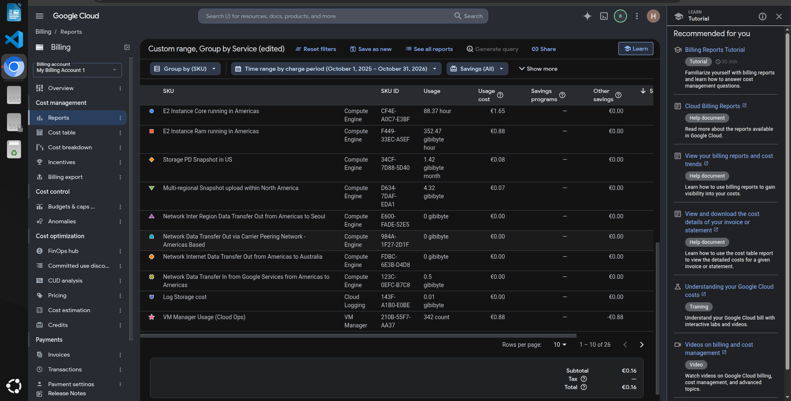

Billing grouped by SKU: the two snapshot lines are the only real cost.

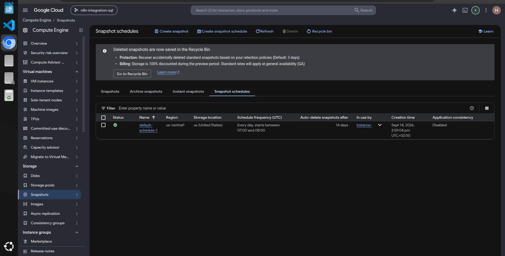

The snapshot schedule attached to the VM's disk, running daily.

**How it was resolved**

In the order that matters: first detached the schedule from the disk (otherwise it creates a new snapshot the next day), then deleted the schedule, then deleted all 17 snapshots and emptied the recycle bin. The VM and its disk were not touched. A €1 budget alert was already in place.

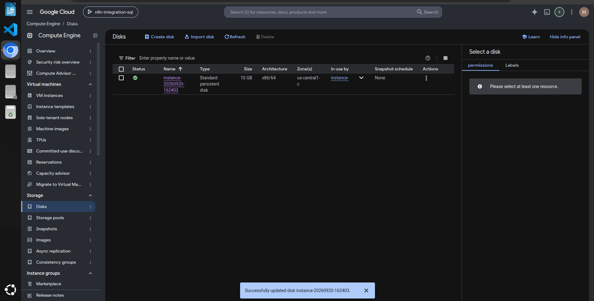

The disk with its snapshot schedule set to None.

**Skill demonstrated**

Grouping cost data at the level that names the cause (SKU, not service); checking defaults created alongside a resource; removing automation in the right order.

## Outcome and Current Status

The system was built twice by design: once to prove the concept end to end with no-code tooling, and once more as independently written Python. The rewrite exposed and fixed a silent data-integrity defect that the first version had never revealed, replaced a fragile external logging dependency with a simpler design native to the system's own database, and added resilience against a production database failure mode that first implementations commonly miss.

### Current status

The Python backend is deployed and running as a Docker container on a Google Cloud VM and answers questions correctly against the complete, verified dataset. The Next.js frontend is live on Vercel (https://ai-data-analyst-agent-hazel.vercel.app) and reaches the backend through a server-side route, so no secret is sent to the browser. Next steps: a repeatable evaluation suite, conversation memory in the Python version, a read-only database role, and rate limiting on the public demo.

### Result

A working AI data analyst, first built as a no-code prototype and then rebuilt from scratch as original code — with its own orchestration, security validation and connection resilience — with eighteen real integration, infrastructure, data and production problems independently diagnosed and resolved.

## Skills Demonstrated

- **Multi-service integration:** connecting a workflow engine or custom backend, a managed database, two LLM providers and (in Phase 1) a spreadsheet API into one working pipeline.
- **Systematic debugging:** isolating which layer of a distributed system is at fault using independent tools (Postman, curl, execution logs, direct database queries) rather than trusting a single error message.
- **Cloud infrastructure literacy:** Postgres connection pooling, IPv4/IPv6 networking, OAuth application setup, API-key scoping, billing and free-tier cost analysis, firewall rules, and containerized deployment.
- **Capacity reasoning:** recognizing that the same memory failure on two providers pointed to the application's footprint, and making an architectural decision from that evidence.
- **Framework fluency under real constraints:** learning LangGraph, LangChain, FastAPI and Pydantic from first principles while porting an existing system's logic faithfully.
- **Data integrity auditing:** treating a fluent, non-crashing answer as insufficient proof of correctness, and catching a real, previously undetected corruption issue using independent ground truth.
- **Production database resilience:** recognizing and engineering around idle-connection reclamation by a managed database pooler.
- **Prompt and context engineering:** schema grounding, few-shot examples and explicit business rules to reduce hallucination, paired with code-level validation so that correctness failures are safe rather than merely less likely.
- **Security hygiene:** validating generated SQL in code rather than trusting the prompt, and redacting secrets from everything shared.
